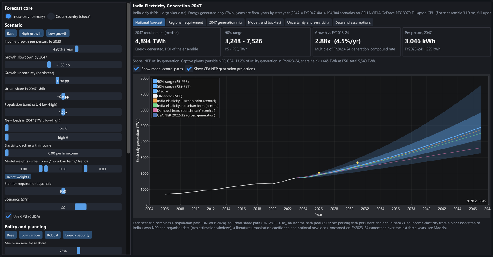

# India Energy 2047

Forecasting India's electricity generation requirement for 2047 and a region-specific plan to meet it.
Team submission for ExxonMobil INNOTHON 2026 (Indian Institute of Science, Bengaluru).



## Headline results (default scenario, primary India-only core)

Years are fiscal years by start year (2023 = FY2023-24, 2047 = FY2047-48).
Scope: utility generation as published by the National Power Portal (NPP).

| | FY2023-24 (observed, NPP) | FY2047-48 median | 80% range (P10-P90) | 90% range (P5-P95) |
| --- | --- | --- | --- | --- |
| National generation | 1,698 TWh | **4,894 TWh** | 3,553 - 6,829 TWh | 3,248 - 7,526 TWh |
| Per person | 1,225 kWh | about 3,050 kWh | | |
| Including captive plants (CEA share held, reported beside the forecast) | 1,922 TWh | about 5,540 TWh | | |

- Income elasticity of generation per person, India's own data: **0.83** (FY2011-12 to FY2023-24; 0.78 in first differences).
- Holdout years not used in fitting: FY2024-25 error -4.0%, FY2025-26 error +1.6%.
- Income growth dominates the uncertainty: +-1.5 points of growth moves the 2047 median by +32% / -24%.
- Independent cross-country check (non-core data, calendar 2047, including captive): 4,528 TWh.

| Region | FY2047-48 requirement (median) | Share of requirement | Share of NPP conventional generation, FY2025-26 |
| --- | --- | --- | --- |
| Northern | 1,395 TWh | 28.5% | 24.9% |
| Western | 1,301 TWh | 26.6% | 36.0% |
| Southern | 1,194 TWh | 24.4% | 20.1% |
| Eastern | 834 TWh | 17.1% | 17.7% |
| North-Eastern | 167 TWh | 3.4% | 1.3% |

Two plans for 2047 (median requirement):

| Plan | Solar | Firmed RE | Coal | Wind (on- and offshore) | Hydro | Nuclear | Gas and bioenergy | Non-fossil | CO2 | Cost | Unmet at median |
| --- | --- | --- | --- | --- | --- | --- | --- | --- | --- | --- | --- |
| Least cost, base policy | 35.0% | 0% | 27.9% | 16.2% | 7.2% | 9.4% | 4.4% | 70.0% | 1,364 Mt | 233 bn USD/yr | 28 TWh |
| **Robust policy (recommended)** | 48.8% | 12.4% | 23.5% | 6.3% | 7.1% | 2.0% | 0% | **76.5%** | **1,114 Mt** | **188 bn USD/yr** | **0 TWh** |

- Firmed RE means solar and wind backed by storage, sold round the clock.
- The Robust plan opens more land for solar (rooftop and agri-PV), triples inter-regional corridors and builds storage-firmed renewables; it is cheaper and cleaner than the base policy.
- Meeting the P90 requirement (6,829 TWh) additionally needs about 45 percent of the solar potential usable at 3.5 times India's record build rate; land, not money, is the binding constraint.
- Details are in [docs/results.md](docs/results.md).

## Compliance rule

Only **energy generated** (GWh or TWh) is used for forecasting and comparison.
Installed capacity and energy consumption are never forecasting inputs or comparison metrics.
The core 2047 prediction uses only the two challenge datasets: NPP generation and the organiser state population and GSDP.
The organiser dataset in [data/raw/competition/](data/raw/competition/) contains installed-capacity columns; only its population and GSDP columns are read.
See [docs/data_audit.md](docs/data_audit.md).

## Method in one paragraph

Generation per person (NPP) is modelled from real income per person (organiser GSDP and population).
The income elasticity is the only parameter estimated; a moving-block bootstrap over two estimation windows carries its uncertainty.
Urbanisation enters only where it runs ahead of income, with a coefficient taken from published studies (the two-dataset-only run is reported beside it).
A Monte Carlo ensemble of 4 million scenarios runs on the GPU in about 30 ms; it combines UN population and urbanisation projections, uncertain income growth, the bootstrap elasticities and state income convergence, and produces national and regional requirements to 2047.
A least-cost linear program (HiGHS) then sites 2047 generation by region and source within resource potentials, firm-generation floors, build-rate limits, policy shares and inter-regional corridor limits.
A 153-country panel model (Ember and World Bank data) is kept as an independent check, not as the forecast.
Full details are in [docs/methodology.md](docs/methodology.md).

## Documents

| Document | Contents |
| --- | --- |
| [docs/methodology.md](docs/methodology.md) | Models, regional split, Monte Carlo, allocation |
| [docs/results.md](docs/results.md) | Forecast tables, regional mixes, sensitivity, performance |
| [docs/assumptions_and_uncertainty.md](docs/assumptions_and_uncertainty.md) | Every assumption, how uncertainty is handled, limitations |
| [docs/data_audit.md](docs/data_audit.md) | Provenance of every input; generation-only compliance |
| [docs/decisions.md](docs/decisions.md) | Design decisions and rejected alternatives |
| [docs/team_plan.md](docs/team_plan.md) | Work plan to the final evaluation |
| [docs/beamer/](docs/beamer/) | Presentation deck (LaTeX Beamer), reader's edition with notes, midpoint slide |
| [docs/deployment.md](docs/deployment.md) | Native and WebAssembly builds, deployment |

## Build

Requirements:

- Windows 10 or 11
- Visual Studio 2022 Build Tools with the C++ workload (MSVC, CMake, Ninja)
- Optional: CUDA Toolkit 12 or newer and an NVIDIA GPU

All other libraries are fetched by CMake: Eigen, HiGHS, GLFW, Dear ImGui and ImPlot.

```bat
build.cmd
```

`build.cmd` loads the MSVC environment, configures with Ninja in `%USERPROFILE%\.e47build` (outside OneDrive), and builds everything.
Useful options:

```bat
build.cmd -DENABLE_CUDA=OFF                      :: CPU only (OpenMP)
build.cmd -DCMAKE_CUDA_ARCHITECTURES=native      :: GPU other than an RTX 30-series
build.cmd -DCMAKE_CUDA_COMPILER="C:/Program Files/NVIDIA GPU Computing Toolkit/CUDA/v13.5/bin/nvcc.exe"
```

## Run

```bat
:: dashboard
%USERPROFILE%\.e47build\apps\e47_dashboard.exe "<repo folder>"

:: command line: fits, timing table, forecast, strategy; writes outputs\*.csv
%USERPROFILE%\.e47build\apps\energy2047.exe "<repo folder>" [draws]

:: tests
%USERPROFILE%\.e47build\tests\test_mc_parity.exe
%USERPROFILE%\.e47build\tests\test_allocation.exe "<repo folder>"

:: save every dashboard view as an image (for slides)
%USERPROFILE%\.e47build\apps\e47_dashboard.exe "<repo folder>" --shot shots
```

## Repository layout

| Path | Contents |
| --- | --- |
| [src/core/](src/core/) | CSV I/O, Philox random numbers, statistics |
| [src/forecast/](src/forecast/) | India-only core (NPP + organiser data), cross-country panel models, bootstrap, backtests, Monte Carlo (CPU and CUDA) |
| [src/regional/](src/regional/) | State income convergence |
| [src/allocation/](src/allocation/) | Strategy inputs, least-cost LP, resource-score allocation, policy sweep |
| [src/pipeline/](src/pipeline/) | End-to-end pipeline used by the tools and the dashboard |
| [apps/](apps/) | `energy2047` command-line tool and `e47_dashboard` |
| [tests/](tests/) | CPU/GPU parity test and allocation test |
| [data/](data/) | Source data (tidy CSV extracts) with SOURCES.md files |
| [docs/](docs/) | Documentation and dashboard images |

## Team

See [TEAM.md](TEAM.md).
