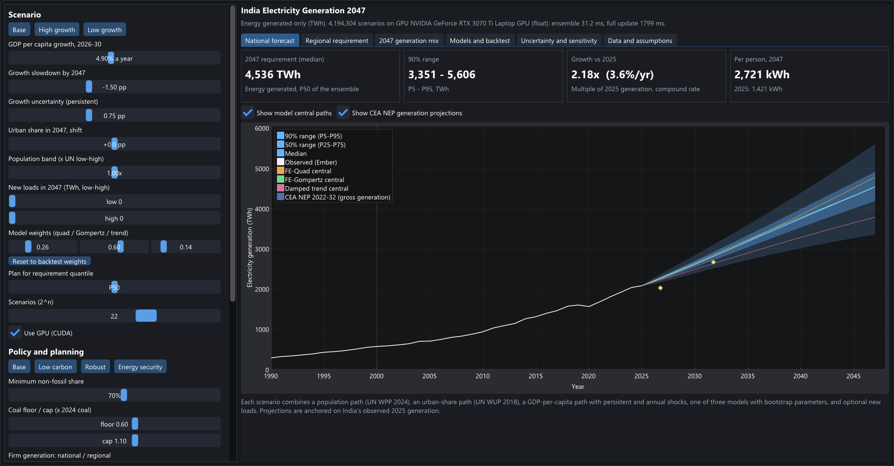
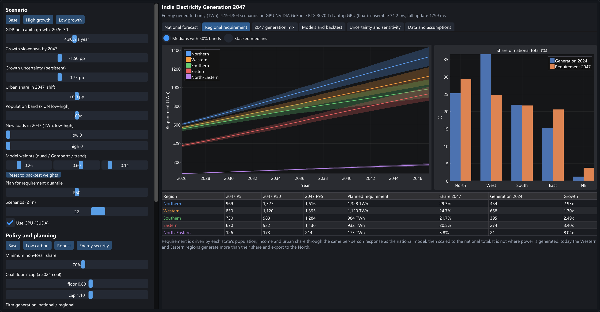

# Results

All numbers are energy generated (TWh).
They come from the default scenario: 4,194,304 Monte Carlo scenarios, seed 20470815.
Regenerate them with `energy2047 <repo_root>`; the tables are written to `outputs/`.

> **Correction, 15 November 2026.** An independent code review found that hydro capacity factors were not being read: the CSV label is `hydro_all`, not `hydro`.
> Every region's hydro potential was therefore computed at a 100 percent capacity factor.
> The fix lowers usable hydro from 948 to about 350 TWh a year.
> It changes the 2047 mix (hydro 17.7 percent became 7.7 percent) but not the requirement forecast.
> All tables below use the corrected model.
> The review's other findings (circulating corridor flows, a one-year convergence offset, score-allocation resource sharing, numeric edge cases) are fixed as well; see [decisions.md](decisions.md), D9.

## 1. National generation requirement

India generated 2,080 TWh in 2025 (Ember, including captive plants), or 1,421 kWh per person.

| Year | P5 | P25 | Median | P75 | P95 |
| --- | --- | --- | --- | --- | --- |
| 2030 | 2,388 | 2,536 | 2,616 | 2,699 | 2,838 |
| 2035 | 2,719 | 3,035 | 3,182 | 3,336 | 3,592 |
| 2040 | 3,010 | 3,527 | 3,751 | 3,986 | 4,390 |
| **2047** | **3,351** | **4,185** | **4,536** | **4,915** | **5,606** |

- The median requirement for 2047 is **4,536 TWh**, 2.18 times the 2025 level (3.6 percent a year).
- Generation per person rises to about 2,720 kWh.
- The 90 percent range is 3,351 to 5,606 TWh.

Central paths of the individual models in 2047, using medium drivers and mean growth:

| Model | 2047 (TWh) | Ensemble weight |
| --- | --- | --- |
| FE-Quad | 4,777 | 0.26 |
| FE-Gompertz | 4,533 | 0.60 |
| Damped trend | 3,782 | 0.14 |

**Cross-check.** The CEA National Electricity Plan projects gross generation of 2,666 TWh for 2031-32.
Our median for 2031 to 2032 is within about 3 percent of it.
That plan was built independently, from bottom-up demand and supply planning.

## 2. Regional requirement

| Region | 2030 median | 2040 median | 2047 P5 | 2047 median | 2047 P95 | Share 2047 | Generation 2024 |
| --- | --- | --- | --- | --- | --- | --- | --- |
| Northern | 735 | 1,085 | 969 | 1,327 | 1,616 | 29% | 454 |
| Western | 671 | 932 | 830 | 1,120 | 1,395 | 25% | 658 |
| Southern | 645 | 849 | 730 | 983 | 1,284 | 22% | 395 |
| Eastern | 473 | 744 | 670 | 932 | 1,136 | 21% | 276 |
| North-Eastern | 95 | 141 | 126 | 173 | 214 | 4% | 21 |

The planned 2047 requirement scales these medians to the national median (4,536 TWh).
Base-year generation is from utilities only, so it excludes captive plants.

Reading the table:

- The **Northern** region has the largest requirement because of its population (Uttar Pradesh, Rajasthan).
- The **Eastern** and **North-Eastern** requirements grow fastest. Two drivers explain this:
  - Bihar and Jharkhand have the fastest-growing populations.
  - Poorer states close their income gap at the rate measured from the organiser GSDP data (2.1 percent of the gap a year).

## 3. 2047 generation strategy

### 3.1 Least-cost plan (base policy)

| Region | Coal | Nuclear | Hydro | Solar | Onshore wind | Offshore wind | Total | Requirement | Net export | Marginal cost (USD/MWh) |
| --- | --- | --- | --- | --- | --- | --- | --- | --- | --- | --- |
| Northern | 431 | 117 | 147 | 504 | 153 | 0 | 1,352 | 1,328 | +24 | 72.5 |
| Western | 317 | 114 | 20 | 608 | 246 | 58 | 1,362 | 1,120 | +241 | 69.7 |
| Southern | 220 | 64 | 34 | 458 | 233 | 88 | 1,097 | 984 | +113 | 69.7 |
| Eastern | 390 | 47 | 28 | 117 | 10 | 0 | 592 | 932 | -340 | 73.0 |
| North-Eastern | 7 | 0 | 120 | 20 | 0 | 0 | 148 | 173 | -25 | 75.6 |

National mix:

| Source | Share |
| --- | --- |
| Solar | 37.5% |
| Coal | 30.0% |
| Onshore wind | 14.1% |
| Hydro | 7.7% |
| Nuclear | 7.5% |
| Offshore wind | 3.2% |
| Gas | 0% |

- Non-fossil share: **70.0 percent**, exactly the policy minimum. The minimum binds.
- CO2 from generation: **1,323 Mt** a year. At the 2024-25 grid average of 0.71 t/MWh, 2,080 TWh today means roughly 1,480 Mt.
- Generation cost: about 202 billion USD a year.
- The base plan has **no headroom**. Planned for the P90 requirement, 447 TWh would be unmet, because land for solar and wind runs out under the 70 percent floor.

### 3.2 How each region's strengths show up

| Region | Mix and reason |
| --- | --- |
| Northern | Rajasthan solar (504 TWh), Himalayan hydro (147 TWh), the existing coal fleet, and Rajasthan and Haryana nuclear sites. Roughly self-sufficient (+24 TWh). |
| Western | Solar and wind (Gujarat, Maharashtra), Gulf of Khambhat offshore wind, central-India coal, and the Jaitapur, Mithi Virdi and Madhya Pradesh nuclear sites. Largest exporter (+241 TWh). |
| Southern | The best wind (Tamil Nadu, Karnataka), Tamil Nadu offshore wind, and Kudankulam, Kaiga and Kovvada nuclear. Exporter (+113 TWh). |
| Eastern | Coal at its fleet limit (1.5 times 2024) and the planned Haripur nuclear site. Solar and wind resources are small, so it imports about 340 TWh. Its marginal cost is the highest of the large regions, which signals where transmission is worth most. |
| North-Eastern | Hydro (Arunachal Pradesh, about 50 GW identified) supplies 81 percent of the region. A small importer at the planning median. |

### 3.3 Resource-score allocation (transparent alternative)

This method keeps the same national totals by source.
It shares them across regions in proportion to usable resource, existing fleets and nuclear sites.

| Region | Net export |
| --- | --- |
| Western | +477 TWh |
| Southern | +188 TWh |
| North-Eastern | -27 TWh |
| Northern | -143 TWh |
| Eastern | -480 TWh |

The direction is the same as the least-cost plan: the West and South export, the East imports.
The transfers are larger because the score ignores corridor limits and losses.

### 3.4 Scenario and policy presets

Each scenario preset is crossed with each policy preset.
The definitions are in [assumptions_and_uncertainty.md](assumptions_and_uncertainty.md), section 6.
The full table is in `outputs/presets.csv`.
"Unmet at P90" re-plans each policy for the 90th-percentile requirement.

| Scenario | Policy | 2047 median (TWh) | Non-fossil | Coal | CO2 (Mt) | Cost (bn USD) | Unmet at median (TWh) | Unmet at P90 (TWh) |
| --- | --- | --- | --- | --- | --- | --- | --- | --- |
| Base | Base | 4,536 | 70.0% | 30.0% | 1,323 | 202 | 0 | 447 |
| Base | Low carbon | 4,536 | 82.8% | 16.7% | 747 | 182 | 0 | 469 |
| Base | **Robust** | 4,536 | **79.2%** | **20.8%** | **920** | **166** | **0** | **0** |
| Base | Energy security | 4,536 | 70.0% | 29.4% | 1,309 | 204 | 0 | 449 |
| High growth | Base | 5,176 | 70.0% | 26.6% | 1,329 | 234 | 312 | 1,323 |
| High growth | Low carbon | 5,176 | 80.0% | 17.0% | 865 | 212 | 334 | 1,345 |
| High growth | Robust | 5,176 | 75.0% | 25.0% | 1,258 | 207 | 0 | 436 |
| High growth | Energy security | 5,176 | 70.0% | 28.2% | 1,370 | 234 | 314 | 1,323 |
| Low growth | Base | 4,108 | 70.4% | 29.6% | 1,183 | 172 | 0 | 0 |
| Low growth | Low carbon | 4,108 | 88.7% | 11.3% | 450 | 154 | 0 | 0 |
| Low growth | Robust | 4,108 | 83.9% | 16.1% | 643 | 144 | 0 | 0 |
| Low growth | Energy security | 4,108 | 70.0% | 30.0% | 1,198 | 175 | 0 | 0 |

**Robust policy mix** (base scenario, share of 2047 generation):

| Source | Share |
| --- | --- |
| Solar | 52.5% |
| Firmed RE (solar and wind with storage, round-the-clock) | 15.1% |
| Coal | 20.8% |
| Hydro | 7.7% |
| Onshore and offshore wind | 2.7% |
| Nuclear | 1.2% |

**What the table shows:**

1. **The binding constraint for 2047 is land and firm clean power, not money.**
   The base plan meets the median but fails one future in ten (447 TWh unmet at P90).
2. **The Robust policy dominates the base policy.**
   It is cheaper (166 vs 202 billion USD a year) and cleaner (920 vs 1,323 Mt CO2).
   It still meets the P90 requirement with zero unmet energy.
   It needs four things:
   - 35 percent of the solar potential usable, including rooftop and agri-PV
   - corridors three times the 2032 plan
   - storage-firmed renewables
   - build rates 2.5 times India's record year
3. **High growth needs the Robust levers.**
   Only the Robust policy serves the high-growth median, and even it leaves 436 TWh unmet at the high-growth P90.
4. **Faster growth raises the requirement only moderately.**
   The fitted models show generation per person saturating with income at the levels India reaches in the 2040s.
   Within countries, urbanisation and income rise together.
   The growth presets therefore also move the urban share: +3 points for high growth, -2 points for low growth.

## 4. Sensitivity

### 4.1 Requirement uncertainty

Each driver's share of the 2047 spread is a rank R-squared, measured one input at a time.

| Driver | Share of the spread |
| --- | --- |
| Urban share path | about 13% |
| Population path | about 9% |
| Model choice | about 9% |
| Persistent GDP growth | about 2% |

The rest comes from bootstrap parameter uncertainty, annual growth shocks and the trend model's own noise.

### 4.2 Policy settings (base plan: 1,323 Mt CO2, 202 billion USD)

Each setting is moved to a low and a high value with everything else fixed.
That is 28 least-cost solves, run in parallel.

| Setting (low / high) | CO2 (Mt) | Unmet (TWh) | Cost (bn USD) |
| --- | --- | --- | --- |
| Requirement (P10 / P90) | 932 / 1,338 | 0 / **447** | 153 / 234 |
| Usable solar land (15% / 35%) | 1,131 / 1,044 | **646** / 0 | 199 / 168 |
| Usable wind land (15% / 35%) | 1,278 / 1,267 | 45 / 0 | 212 / 196 |
| Carbon price (0 / 60 USD/t) | 1,323 / 1,048 | 0 / 0 | 202 / 210 |
| Nuclear cost (0.7x / 1.3x) | 1,216 / 1,323 | 0 / 0 | 192 / 209 |
| Coal cost (0.7x / 1.3x) | 1,323 / 1,216 | 0 / 0 | 174 / 228 |
| Non-fossil minimum (60% / 85%) | 1,415 / infeasible | 0 / - | 202 / - |
| Corridor capacity (1x / 3x the 2032 plan) | 1,309 / 1,323 | 0 / 0 | 203 / 202 |
| Firmed RE cost (0.7x / 1.5x) | 1,323 / 1,323 | 0 / 0 | 196 / 202 |

Two rows have no effect at the defaults: firm-generation floors and build-rate acceleration.

**Reading the table:**

- Lower CO2 at 15 percent solar land is not an improvement. It comes from unmet requirement.
- An 85 percent non-fossil target cannot be met unless coal retires faster than the 60 percent fleet floor.

## 5. Performance

| Run | 1,048,576 scenarios | Scenarios per second |
| --- | --- | --- |
| CPU, 1 thread | 22.7 s | 46,000 |
| CPU, 16 threads (OpenMP) | 2.07 s | 507,000 |
| GPU, RTX 3070 Ti Laptop (CUDA) | 7.5 ms | 140 million |

These were measured on an otherwise idle machine on 15 November 2026.
CPU timings vary with background load.

The full dashboard update takes about 1.8 s:

- 4.2 million scenarios on the GPU, about 30 ms.
- Least-cost and score allocations.
- The policy sweep.
- Bootstrap of 2,000 replicates for each of two models: 2.2 s on 16 threads, once at start-up.
