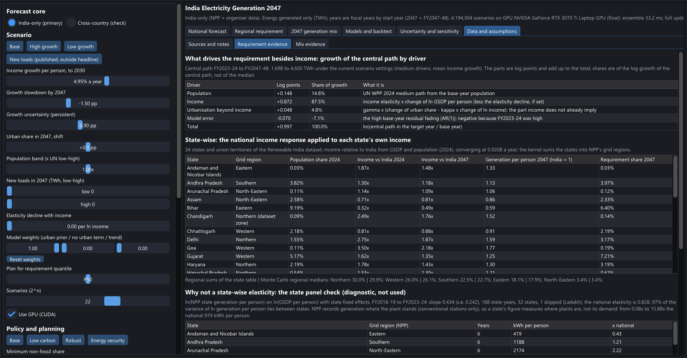
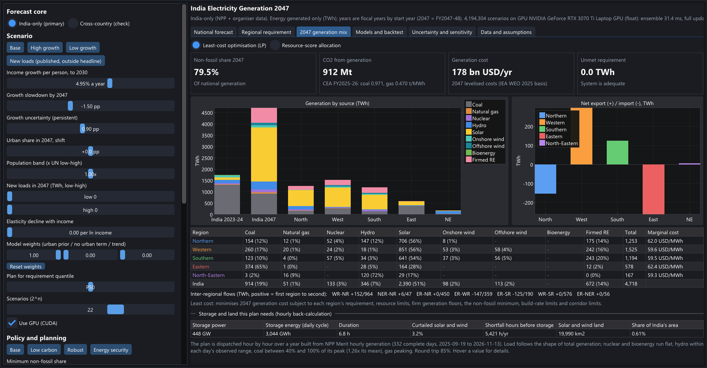
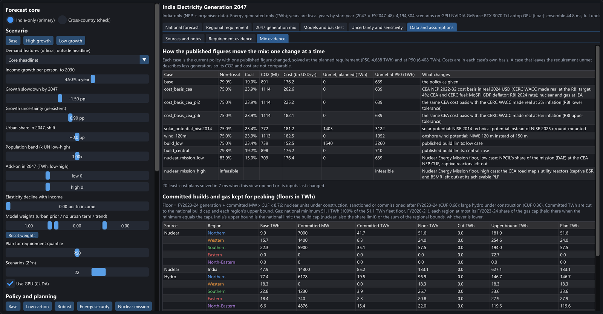

# Results

All numbers are energy generated (TWh).
They come from the default scenario of the primary (India-only) core: 4,194,304 Monte Carlo scenarios, seed 20470815.
Regenerate them with `energy2047 <repo_root>`; the tables are written to `outputs/`.

Years are fiscal years labelled by their start year: 2023 is FY2023-24, 2047 is FY2047-48.
The scope is the country's total NPP utility generation, and the headline is that total in TWh, not generation per person.

> **Change, 16 November 2026.** The organisers ruled at the kickoff that the core 2047 prediction must use only the two challenge datasets (National Power Portal and the Renewable India dataset).
> The primary forecast is now the India-only model ([methodology.md](methodology.md), section 2).
> The earlier cross-country model is kept as an independent check (section 1.4).
>
> **Update, 16 November 2026, after an independent code review.** The base-year anchor rule was replaced by an AR(1) model-error term, GSDP values copied unchanged from the previous year are no longer counted as zero income growth, and the bootstrap was corrected ([decisions.md](decisions.md), D11).
>
> **Update, 16 November 2026, after the organisers' written ruling.** The captive layer is removed, the regional split uses only the challenge data (dataset state populations and NPP grid regions), and the cross-country model is used for justification only ([decisions.md](decisions.md), D12).
> The national forecast does not change; the regional requirements and, through them, the regional plans do.
>
> **Update, 19 November 2026, after the midpoint review** ([decisions.md](decisions.md), D13).
> Part 1, the requirement, gains evidence but does not change: a growth decomposition, elasticity sensitivities, a state-by-state table, a state panel check and a new-loads scenario outside the headline (sections 1.5, 1.6, 2.2 and 4.1). The forecast files are byte-identical to the midpoint run.
> Part 2, the mix, now uses published figures, per the kickoff guidance: a FY2023-24 regional base mix from NPP (conventional, primary) and CEA (renewables, secondary) instead of Ember, published build limits instead of record years, committed nuclear and hydro builds, the gas fleet kept for peaking in the Robust policy, CEA v22 emission factors, and mix sensitivities (sections 3.7 and 3.8).
> Every number below is from the run that includes these changes.
>
> **Update, 21 November 2026, after the final presentation** ([decisions.md](decisions.md), D14).
> Every money figure is now in real 2024 USD, converted with official price indices; the CEA cost basis is fully real, and the default (IEA) plan does not change.
> Jammu and Kashmir's GSDP, which the organiser dataset gives at current prices from 2012, is deflated with the MoSPI GDP deflator: the FY2047-48 median moves from 4,703 to 4,688 TWh.
> Placeholder years no longer set a state's convergence base year: the convergence speed falls from 0.0208 to 0.0021, and the regional split changes a lot.
> A demand-feature layer from official sources (44 drivers catalogued, 11 quantified) gives named scenarios and a joint distribution outside the headline (section 1.6; [demand_features.md](demand_features.md)); it replaces the new-loads scenario.
> The decks and talk materials show the results presented on 21 November; D14 records every change since.

## 1. National generation requirement

India's utilities generated 1,698 TWh in FY2023-24 (NPP).

| Year | P5 | P10 | P25 | Median | P75 | P90 | P95 |
| --- | --- | --- | --- | --- | --- | --- | --- |
| FY2030-31 | 1,947 | 2,012 | 2,126 | 2,262 | 2,410 | 2,554 | 2,647 |
| FY2035-36 | 2,304 | 2,418 | 2,624 | 2,879 | 3,164 | 3,453 | 3,641 |
| FY2040-41 | 2,678 | 2,854 | 3,176 | 3,585 | 4,059 | 4,548 | 4,875 |
| **FY2047-48** | **3,190** | **3,471** | **3,997** | **4,688** | **5,516** | **6,408** | **7,021** |

- The median requirement for FY2047-48 is **4,688 TWh**, 2.76 times FY2023-24 (4.3 percent a year).
- That is **2,990 TWh more** than the 1,698 TWh generated in FY2023-24.
- The 80 percent range (P10 to P90) is 3,471 to 6,408 TWh.

Central paths in FY2047-48 (medium drivers, mean growth, point estimates, expected model-error path):

| Model | FY2047-48 (TWh) | Role |
| --- | --- | --- |
| India elasticity with the urbanisation prior | 4,589 | Forecast (weight 1) |
| India elasticity, no urban term (gamma = 0; UN population path still used) | 4,374 | Ablation |
| Damped trend on NPP generation (no drivers) | 3,604 | Benchmark |

### 1.1 Estimation

| Quantity | Value |
| --- | --- |
| Income elasticity, FY2011-12 to FY2023-24 | 0.835 (s.e. 0.065) |
| Income elasticity, FY2006-07 to FY2023-24 (spliced price bases) | 0.872 (s.e. 0.032) |
| First-difference elasticity (pandemic years and the imputed 2011 change left out) | 0.786 / 0.789 |
| Elasticity used: block-bootstrap mixture of both windows | median 0.857, 90% interval 0.737 to 0.947 |
| FY2020-21 (pandemic) effect | -0.055 log points |
| Urbanisation prior gamma | normal(1.0, 0.5), truncated at 0 |
| Model error | AR(1) residual starting at +0.072 log points (FY2023-24), persistence 0.51 (Durbin-Watson 0.97), residual s.d. 0.037 |
| Imputed 2011 growth of GSDP per person (price-base splice) | 4.59 percent |
| Income growth per person, FY2012-13 to FY2023-24 without the pandemic years | mean 4.90 percent, s.d. 1.51 percent, persistence 0.63 |
| GSDP price basis | constant 2011-12 prices; Jammu and Kashmir from 2012 (13 state-years, current prices) deflated with the MoSPI GDP deflator (secondary) |

### 1.2 Validation

| Check | Result |
| --- | --- |
| Rolling backtest, origins FY2012-13 to FY2018-19, MAPE at 1 / 3 / 5 years | 2.0% / 4.1% / 6.4% |
| Holdout FY2024-25 (NPP conventional 1,569 + renewable extended 216 = 1,785) | model 1,726 (P5 to P95: 1,630 to 1,828), error -3.3% |
| Holdout FY2025-26 (1,530 + 247 = 1,776) | model 1,785 (1,658 to 1,923), error +0.5% |

Both holdout years fall inside the model's 90 percent range.
NPP has no renewable generation for the holdout years, so renewable output is extended at its FY2018-19 to FY2023-24 growth rate (14.1 percent a year).
Conventional generation alone fell 2.5 percent in FY2025-26 while renewable output kept rising, so a check on conventional output alone would be biased.

### 1.3 Scope: no captive layer

The forecast covers NPP utility generation only.
Captive plants inside industries are outside the NPP series.
Earlier runs reported a captive layer beside the forecast from CEA data; the organisers' ruling of 16 November 2026 (NPP generation only, no external data for estimation) rules that out, so it is no longer computed or reported ([decisions.md](decisions.md), D12).

### 1.4 Independent check: cross-country model

The cross-country model uses data outside the challenge datasets, so it is used for justification only, not for estimation.

| Core | Scope | Base | 2047 P5 | 2047 median | 2047 P95 |
| --- | --- | --- | --- | --- | --- |
| India-only (primary) | NPP utilities, FY2047-48 | 1,698 (FY2023-24) | 3,190 | 4,688 | 7,021 |
| Cross-country panel (independent check) | Ember total generation (beyond NPP's utility series), calendar 2047 | 2,080 (2025) | 3,348 | 4,528 | 5,610 |

The cross-country median lies inside the India-only range, 3.4 percent below the India-only median, although its scope (total generation) is wider.
The difference is the elasticity: across 153 countries the elasticity at India's income is 0.44 to 0.57, falling with income; India's own data show 0.79 to 0.87 with no decline yet.
Setting an elasticity decline of 0.2 per unit of ln income in the India model gives 4,194 TWh (section 4), which brings the two methods together.

**CEA benchmarks (generation only).**

- The CEA National Electricity Plan 2022-32 projects gross generation of 2,666 TWh for FY2031-32. Our median for FY2031-32 is 2,378 TWh, 11 percent lower; CEA's figure lies between our P75 (2,550) and P90 (2,719).
- CEA's 2026 review gives about 3,596 BU of gross generation for 2035-36 (press reports; the document is not public). Our median for FY2035-36 is 2,879 TWh, 19.9 percent lower; CEA's figure is close to our P95 (3,641).
- CEA's energy requirement projections (the Electric Power Surveys, for example 2,474 BU for FY2031-32) are consumption-side and ex-bus, so they are context only and never a benchmark for generation.

The registration-form figure of 6,000 TWh was a pre-data estimate; it lies between our P75 (5,516) and P90 (6,408).

### 1.5 What drives the total

Income is the largest driver of the 2047 requirement, but not the only one.
`outputs/growth_decomposition_2047.csv` splits the growth of the central path, 1,698 TWh in FY2023-24 to 4,589 TWh in FY2047-48 (0.994 log points), into its parts ([methodology.md](methodology.md), section 2.8):

| Part | Log points | Share of growth |
| --- | --- | --- |
| Population (UN WPP 2024 medium) | 0.148 | 14.8% |
| Income (elasticity 0.835 x the change in ln GSDP per person) | 0.870 | 87.5% |
| Urbanisation beyond the income path (gamma 1.0) | 0.048 | 4.8% |
| Model error (the high FY2023-24 residual, +0.072, fading) | -0.072 | -7.2% |
| **Total** | **0.994** | **100%** |

The decomposition is of the central path (4,589 TWh), not of the median (4,688 TWh).
The elasticity is estimated for India as a whole; its sensitivities are in section 4.1: one standard error either way moves the median by -6.5 or +7.0 percent, about 1 percent per 0.01 of elasticity.

### 1.6 Demand features (a separate layer, outside the headline)

Every other driver of the 2047 requirement is listed in [demand_features.md](demand_features.md): 44 drivers. Every quantified size comes from an official source (secondary); six unquantified rows have no external source.
7 are estimated in the core forecast, 3 are existing drivers or settings, 1 is excluded by the organisers' ruling (captive generation) and 22 are context.
The other 11 are quantified as signed TWh adjustments to FY2047-48 generation, beyond the historical trend, and form a layer that is never the headline (`outputs/feature_scenarios_2047.csv`):

| Scenario | Adjustment, TWh | P5 | P50 | P95 | P50 vs headline |
| --- | --- | --- | --- | --- | --- |
| Core (headline) | 0 | 3,190 | 4,688 | 7,021 | |
| Features central | +1,122.4 | 4,313 | 5,810 | 8,143 | +23.9% |
| Electrification high | +1,839.9 | 5,030 | 6,528 | 8,860 | +39.3% |
| Efficiency and distributed | +388.6 | 3,579 | 5,076 | 7,409 | +8.3% |
| Climate stress | +1,374.7 | 4,565 | 6,063 | 8,395 | +29.3% |
| All upside | +1,866.8 | 5,057 | 6,555 | 8,887 | +39.8% |
| All downside | +177.3 | 3,368 | 4,865 | 7,198 | +3.8% |
| Joint (core draws plus independent feature draws) | drawn | 4,130 | 5,668 | 8,017 | +20.9% |

TWh in FY2047-48.

- Every combination of feature levels lies between All downside and All upside.
- T&D losses may already be inside the trend, so they count only as an upper bound: 0 at central, up to -476 TWh in the downside scenarios.
- The Robust plan meets the joint median (5,668 TWh) in full; planned for the joint P90 (7,404 TWh) it leaves 1,635 TWh unmet, against 639 TWh at the headline P90.
- The plan is stress-tested at the headline P90 (6,408 TWh), which is 1,720 TWh above the median.

## 2. Regional requirement

| Region | FY2030-31 median | FY2040-41 median | FY2047-48 P5 | FY2047-48 median | FY2047-48 P95 | Share of requirement 2047 | Share of NPP conventional generation FY2025-26 |
| --- | --- | --- | --- | --- | --- | --- | --- |
| Northern | 618 | 1,007 | 914 | 1,342 | 2,003 | 28.6% | 24.9% |
| Western | 604 | 969 | 866 | 1,276 | 1,921 | 27.2% | 36.0% |
| Southern | 622 | 940 | 799 | 1,188 | 1,811 | 25.3% | 20.1% |
| Eastern | 347 | 555 | 491 | 730 | 1,086 | 15.6% | 17.7% |
| North-Eastern | 72 | 115 | 102 | 151 | 224 | 3.2% | 1.3% |

The requirement is where power is needed (state population and income in the challenge dataset); NPP generation is where plants are today.
Shares of requirement are the planned requirements of `outputs/strategy_2047_regions.csv` (the national median split by the regional medians).
Since 21 November the split uses Jammu and Kashmir's deflated GSDP and a convergence base year that skips placeholder runs; the convergence speed fell from 0.0208 to 0.0021, so relative incomes now barely converge by 2047 ([decisions.md](decisions.md), D14).

- **Transfer gap.** The Western region produces 36 percent of India's conventional generation but accounts for 27 percent of the 2047 requirement; the Northern, Southern and North-Eastern regions need more than they produce today, and the Eastern region needs less (15.6 against 17.7 percent).
- The **Northern** region has the largest requirement because of its population (Uttar Pradesh, Rajasthan, Delhi); its share of India's population rises from 31.3 to 32.4 percent by 2047 because its states grew faster than India in the dataset.
- The **Southern** region's population share falls from 19.6 to 17.6 percent by 2047, because its states grew more slowly than India in 2019-2024 (Tamil Nadu 0.37, Kerala 0.45, Andhra Pradesh 0.43 percent a year against 0.97 percent); its higher income keeps its share of requirement (25.3 percent) well above its population share.
- The **North-Eastern** share of the requirement (3.2 percent) is more than twice its share of today's production (1.3 percent).

### 2.1 State population paths and the consistency check

State populations start from the challenge dataset's 2024 values and grow at the UN WPP 2024 medium growth of India plus each state's own 2019-2024 offset from India's growth in the dataset ([methodology.md](methodology.md), section 4).
States sit in the grid region NPP reports them under; the dataset's Zone is used only where NPP does not list a state (Chandigarh), and NPP prevails where the two disagree (Andaman and Nicobar Islands and Sikkim are Eastern, Rajasthan is Northern).
The 34 states and union territories are those with a 2024 population in the dataset; Ladakh and Dadra and Nagar Haveli and Daman and Diu have none.

`outputs/population_consistency.csv` checks the paths against the dataset, as the organisers' ruling asks:

| Percent a year | Challenge dataset 2011-2024 | Challenge dataset 2019-2024 | Model 2024-2030 | Model 2024-2047 |
| --- | --- | --- | --- | --- |
| India | 1.12 | 0.97 | 0.83 (= UN WPP 2024 medium) | 0.60 (= UN WPP 2024 medium) |
| Fastest state (Puducherry) | 2.33 | 2.27 | 2.13 | 1.90 |
| Slowest state (Lakshadweep) | 0.57 | 0.29 | 0.15 | -0.08 |

- Every state's path to 2030 lies 0.14 points a year below its own 2019-2024 growth: the same gap as between the dataset's national growth and UN growth, so the dataset's ranking of states is kept.
- The dataset's 2024 total (1.399 billion) is close to the Technical Group projection for 1 July 2024 (1.403 billion), which is shown as a reference column only.

| Region, share of population | 2024 (dataset) | 2047 (model) |
| --- | --- | --- |
| Northern | 31.3% | 32.4% |
| Western | 22.8% | 23.4% |
| Southern | 19.6% | 17.6% |
| Eastern | 22.6% | 22.9% |
| North-Eastern | 3.7% | 3.7% |

### 2.2 Income state by state

Income enters the split state-wise: each of the 34 states and union territories has its own GSDP per person from the Renewable India dataset (Jammu and Kashmir deflated to constant prices), relative to India's.
The gaps converge at 0.2 percent a year (lambda 0.0021, s.e. 0.0051), which is essentially no convergence by 2047; each state's convergence base year skips its placeholder years ([methodology.md](methodology.md), section 4).
`outputs/state_income_2047.csv` shows the split on the central path; selected states:

| State | Grid region | Population share, 2024 | Income relative to India, 2024 to 2047 | Generation per person relative to India's, 2047 | Population share, 2047 | Share of the 2047 requirement |
| --- | --- | --- | --- | --- | --- | --- |
| Uttar Pradesh | Northern | 17.0% | 0.42 to 0.44 | 0.54 | 17.6% | 9.9% |
| Maharashtra | Western | 9.1% | 1.37 to 1.35 | 1.25 | 8.8% | 11.5% |
| Bihar | Eastern | 9.2% | 0.32 to 0.34 | 0.45 | 10.3% | 4.8% |
| Gujarat | Western | 5.2% | 1.63 to 1.59 | 1.41 | 5.5% | 8.2% |
| Tamil Nadu | Southern | 5.5% | 1.69 to 1.65 | 1.45 | 4.8% | 7.2% |
| Delhi | Northern | 1.6% | 2.77 to 2.64 | 2.06 | 1.9% | 4.1% |

- Generation per person relative to India's runs from 0.45 (Bihar) to 2.44 (Goa) in 2047. It equals relative income to the power 0.742: the elasticity 0.835 less gamma x kappa (1.0 x 0.093), the income-linked part of the urbanisation term, which the split keeps because the dataset has no state urban share ([methodology.md](methodology.md), section 4).
- Summed by region, the state table gives Northern 28.7, Western 27.2, Southern 25.2, Eastern 15.8 and North-Eastern 3.2 percent of the requirement, within 0.2 points of the Monte Carlo regional medians (28.6, 27.2, 25.3, 15.6 and 3.2 percent).

### 2.3 State panel check: why the elasticity is not estimated state by state

`outputs/state_panel_check.csv` is a diagnostic only, never used by the forecast.
It regresses ln(NPP state generation per person) on ln(GSDP per person) with state fixed effects, FY2018-19 to FY2023-24.

| Quantity | Value |
| --- | --- |
| Within slope (s.e., not clustered by state) | 0.522 (0.258) |
| State-years; states | 188; 32 (Ladakh skipped: not in the dataset; Goa: no NPP generation) |
| National elasticity, for comparison | 0.835 (s.e. 0.065) |
| National conventional generation per person, FY2018-19 to FY2023-24 | 979 kWh |
| State generation per person relative to national | 0.08 (Nagaland) to 15.9 (Sikkim); Himachal Pradesh 5.2, Chhattisgarh 4.7, Delhi 0.26, Kerala 0.20 |
| Share of the variance of ln generation per person between states | 97.1% |

NPP state generation covers conventional stations only and is recorded where the plant stands, so a state's figure measures where plants are, not what the state needs.
The fixed effects absorb 97 percent of the variance, and the slope rests on six years of movement within states, which include the pandemic year and new plants.
Its standard error is almost four times the national one, and the national 0.835 lies within two of its standard errors.
The elasticity is therefore estimated where generation and need coincide, India as a whole, and applied state by state (section 2.2).

## 3. 2047 generation strategy

The dashboard image shows the recommended Robust plan (section 3.2).
Every plan starts from the FY2023-24 regional mix (NPP conventional generation plus CEA renewables) and is bounded by published build limits and committed builds (section 3.7).
These published figures are used in Part 2 only, following the kickoff guidance, and each is labelled secondary; none enters the requirement.

### 3.1 Least-cost plan, base policy

From `outputs/strategy_2047.csv` and `outputs/strategy_2047_regions.csv` (TWh):

| Region | Coal | Gas | Nuclear | Hydro | Solar | Onshore wind | Offshore wind | Bioenergy | Requirement | Net export | Marginal cost (USD/MWh) |
| --- | --- | --- | --- | --- | --- | --- | --- | --- | --- | --- | --- |
| Northern | 410 | 0 | 121 | 147 | 504 | 153 | 0 | 4 | 1,343 | -3 | 107.7 |
| Western | 370 | 0 | 170 | 18 | 608 | 246 | 18 | 0 | 1,276 | +153 | 103.9 |
| Southern | 246 | 0 | 129 | 34 | 458 | 233 | 88 | 0 | 1,188 | 0 | 103.9 |
| Eastern | 374 | 0 | 48 | 28 | 117 | 10 | 0 | 9 | 730 | -143 | 108.3 |
| North-Eastern | 8 | 0 | 0 | 120 | 20 | 0 | 0 | 1 | 151 | -1 | 112.2 |

National mix: solar 36.4%, coal 30.0%, onshore wind 13.7%, nuclear 10.0%, hydro 7.4%, offshore wind 2.3%, bioenergy 0.3%; no gas.
Non-fossil share 70.0 percent (the minimum binds, so coal fills the remaining 30 percent); CO2 1,367 Mt; about 213 billion USD a year (real 2024 USD).
Nuclear sits at its 10 percent share limit, above the committed floor; hydro sits at its usable potential (346 TWh).

**The base policy meets the median requirement in every region.**
The Eastern region imports 143 TWh: the West-East corridor carries 148 TWh before losses, 62 percent of its capability; the South sends none.
The West also sends 4 TWh to the North, and the North sends 1 TWh to the North-Eastern region.
Regional marginal costs (the duals of the regional balances) are 104 to 112 USD/MWh.
The plan has no margin for a higher requirement: planned for the 90th percentile (6,408 TWh) it leaves 1,471 TWh unmet (section 4.2).

### 3.2 Recommended plan: Robust policy

| Source | Share of 2047 generation |
| --- | --- |
| Solar | 50.9% |
| Coal | 19.0% |
| Firmed RE (solar and wind with storage, round-the-clock) | 14.6% |
| Hydro | 7.4% |
| Nuclear | 2.8% |
| Offshore wind | 2.4% |
| Onshore wind | 1.8% |
| Gas | 1.1% |

| Region | Coal | Gas | Nuclear | Hydro | Solar | Wind (on- and offshore) | Firmed RE | Total | Requirement | Net export |
| --- | --- | --- | --- | --- | --- | --- | --- | --- | --- | --- |
| Northern | 137 | 12 | 52 | 147 | 706 | 8 | 175 | 1,236 | 1,343 | -107 |
| Western | 260 | 20 | 24 | 18 | 851 | 96 | 256 | 1,525 | 1,276 | +249 |
| Southern | 123 | 4 | 57 | 34 | 641 | 93 | 243 | 1,194 | 1,188 | +6 |
| Eastern | 371 | 1 | 0 | 28 | 164 | 0 | 12 | 575 | 730 | -155 |
| North-Eastern | 3 | 16 | 0 | 120 | 29 | 0 | under 1 | 167 | 151 | +16 |

TWh. The six sources by region are `plan.vectors` in `outputs/site_summary.json`; totals, requirements and net exports are `plan.regions`; firmed RE is the regional total less the six sources (Robust has no bioenergy). National shares are in `outputs/presets.csv`.

Each region uses its strengths, as published resources and today's fleet suggest:

- **Northern:** Rajasthan solar and Himalayan hydro; it imports 107 TWh (94 TWh from the West and 16 TWh from the North-East before losses).
- **Western:** Gujarat and Maharashtra solar and wind; the largest exporter (249 TWh) and the largest gas region (20 TWh, 38 percent of the gas kept for peaking).
- **Southern:** solar, wind and the largest nuclear share (57 TWh, Kudankulam and Kalpakkam); it is close to balance and sends 6 TWh to the East.
- **Eastern:** the coal fleet (371 TWh, 41 percent of the plan's coal); it imports 155 TWh (155 TWh from the West and 6 TWh from the South before losses).
- **North-Eastern:** Arunachal hydro (120 TWh) and Assam and Tripura gas (16 TWh); it exports 16 TWh to the North.

Non-fossil 79.9 percent; CO2 891 Mt; about 176.2 billion USD a year (real 2024 USD); **no unmet energy at the median**.
At the median it is cheaper (by 37 billion USD a year) and cleaner (by 476 Mt of CO2) than the base policy.
At P90 it leaves 639 TWh unmet instead of 1,471 TWh, and it costs more there, about 253 billion USD a year against 236, because it generates more.
It needs 35 percent of the solar potential usable (including rooftop and agri-PV), 30 percent of the wind potential, corridors three times the 2032 plan and build rates at the published high-case limits; its coal floor is 50 percent of FY2023-24 coal, and it keeps the existing gas fleet at its best NPP year (51 TWh) for peaking.
Nuclear is at its committed floor in every region (133 TWh); hydro is at its usable potential (346 TWh).

### 3.3 What the P90 requirement takes

Planned for the 90th-percentile requirement (6,408 TWh), the Robust policy leaves 639 TWh unmet.
Land for solar is the binding constraint (`outputs/p90_levers.csv`, unmet TWh):

| Build limits (x the published high case) | 35% usable solar | 45% | 55% |
| --- | --- | --- | --- |
| 1.0 | 639 | 0 | 0 |
| 1.25 | 420 | 0 | 0 |
| 1.5 | 264 | 0 | 0 |
| 2.0 | 217 | 0 | 0 |

Faster building alone does not close the gap: twice the published high-case limits still leaves 217 TWh unmet.
Usable solar land (rooftop, agri-PV, canal-top and floating solar) does: 45 percent of the potential meets the P90 already at the published high-case limits, for about 258 billion USD a year (244 billion with 55 percent).
These levers were tested at the headline P90 only; at the core-plus-features joint P90 (7,404 TWh) the Robust plan leaves 1,635 TWh unmet (section 1.6).

### 3.4 Scenario and policy presets

Each scenario preset is crossed with each policy preset ([assumptions_and_uncertainty.md](assumptions_and_uncertainty.md), section 6; full table in `outputs/presets.csv`).

| Scenario | Policy | 2047 median (TWh) | Non-fossil | Coal | CO2 (Mt) | Cost at median (bn USD) | Unmet at median (TWh) | Unmet at P90 (TWh) |
| --- | --- | --- | --- | --- | --- | --- | --- | --- |
| Base | Base | 4,688 | 70.0% | 30.0% | 1,367 | 213 | 0 | 1,471 |
| Base | Low carbon | 4,688 | 82.1% | 17.9% | 816 | 191 | 0 | 1,493 |
| Base | **Robust** | 4,688 | **79.9%** | **19.0%** | **891** | **176** | **0** | **639** |
| Base | Energy security | 4,688 | 70.0% | 30.0% | 1,367 | 214 | 0 | 1,471 |
| High growth | Base | 6,580 | 70.1% | 28.8% | 1,407 | 236 | 1,643 | 4,172 |
| High growth | Robust | 6,580 | 75.0% | 24.1% | 1,375 | 253 | 812 | 3,341 |
| Low growth | Base | 3,377 | 77.1% | 22.9% | 754 | 127 | 0 | 0 |
| Low growth | Robust | 3,377 | 79.4% | 19.1% | 653 | 125 | 0 | 0 |

Costs are in real 2024 USD.
In the base scenario every policy meets the median; they differ in cost, CO2 and the shortfall at P90.
The Robust policy is the cheapest and leaves the smallest P90 shortfall; the Low carbon policy emits least.
Since 21 November the High growth preset has no fixed new-loads add-on (it had 100 to 300 TWh without an official source, about 200 TWh at the median); its median is 6,580 TWh, against 6,785 TWh in the run presented on 21 November. Demand features enter only through the feature scenarios (section 1.6).

**Stress test at the 5th percentile** (`outputs/presets.csv`, columns `unserved_at_p05_twh` and `cost_at_p05_busd`).
Every policy has a feasible plan at the Base scenario's P05 (3,190 TWh) and at every scenario's median.
At the Low growth scenario's P05 (2,306 TWh), the Base, Robust and Energy security policies have no feasible plan; Low carbon has one (86.1 billion USD a year).
The reason is a known limit ([decisions.md](decisions.md), D13): the coal floor (for Robust, 50 percent of each region's FY2023-24 coal, 647 TWh) and the gas kept for peaking (51 TWh) are fixed in TWh, while the non-fossil minimum (75 percent) is a share of generation.
Below about (647 + 51) / 0.25 = 2,794 TWh of generation the two floors exceed the fossil allowance; the lowest feasible requirement found by bisection is 2,780 TWh.
The Base policy's bound is about 2,590 TWh and Energy security's about 3,020 TWh. The dashboard explains the infeasible state and names the levers: the coal floor, the gas kept for peaking and the non-fossil minimum.
As at the midpoint, High growth with the Energy security policy has no feasible plan at P90.

### 3.5 Cost of deeper CO2 cuts

The recommended plan (Robust policy, median requirement) is re-solved under a falling national CO2 cap ([methodology.md](methodology.md), section 6.5; `outputs/pareto_2047.csv`).

| CO2 (Mt) | Cost (bn USD/yr) | Marginal abatement cost (USD/t) | Non-fossil | Coal | Nuclear |
| --- | --- | --- | --- | --- | --- |
| 891 (no cap) | 176.16 | 0 | 79.9% | 19.0% | 2.8% |
| 871 | 176.18 | 1.03 | 80.3% | 18.6% | 3.3% |
| 852 | 176.20 | 1.03 | 80.8% | 18.1% | 3.7% |
| 832 | 176.22 | 1.03 | 81.2% | 17.7% | 4.1% |
| 812 | 176.24 | 1.40 | 81.6% | 17.3% | 4.6% |
| 792 | 176.27 | 1.40 | 82.1% | 16.8% | 5.0% |
| 772 | 176.30 | 1.40 | 82.5% | 16.4% | 5.5% |
| 752 | 176.33 | 1.40 | 83.0% | 16.0% | 5.9% |
| 732 | 176.36 | 1.40 | 83.4% | 15.5% | 6.3% |
| 712 | 176.39 | 4.04 | 83.8% | 15.1% | 6.8% |
| 692 | 176.46 | 4.04 | 84.3% | 14.7% | 7.2% |
| 673 | 176.53 | 4.04 | 84.7% | 14.2% | 7.7% |
| **653** | **176.60** | **4.04** | **85.1%** | **13.8%** | **8.1%** |

- **Deeper cuts cost almost nothing.** Cutting the plan's CO2 from 891 to 653 Mt a year (27 percent) raises its cost from 176.16 to 176.60 billion USD a year (real 2024 USD): 0.45 billion USD, or 0.3 percent.
- The marginal abatement cost rises in steps from 1.03 to 4.04 USD per tonne; the average over the whole cut is about 1.9 USD per tonne.
- Nuclear replaces coal: its share rises from 2.8 to 8.1 percent while coal falls from 19.0 to 13.8 percent.
  Solar (50.9 percent) and firmed RE (14.6 percent) hardly change, because solar is already at its usable land limit, and gas stays at 1.1 percent, the fleet kept for peaking.
- **The coal fleet floor is the limit.** At 653 Mt every region's coal is at the Robust policy's floor of 50 percent of its FY2023-24 output (647 TWh nationally, 629 Mt at the CEA v22 factor of 0.971 t CO2 per MWh), because the fleet is young; the gas kept for peaking adds 24 Mt (51 TWh at 0.470).
  Any lower cap could only be met by leaving requirement unserved.

### 3.6 Storage and land the plans need

Each least-cost plan is dispatched hour by hour over a representative year built from NPP Merit hourly generation ([methodology.md](methodology.md), section 6.4; full table in `outputs/storage_land_2047.csv`).
Storage power and energy are physical sizes of the plan, not forecasts.

| Plan (2047 requirement) | Storage power | Storage energy (daily cycle) | Duration | Curtailed solar and wind | Shortfall left after storage | Solar and wind land | Share of India's area |
| --- | --- | --- | --- | --- | --- | --- | --- |
| **Robust policy, median (4,688 TWh)** | **448 GW** | **3,048 GWh** | **6.8 h** | **3.2%** | **231 TWh (4.9%)** | **19,990 km²** | **0.61%** |
| Base policy, median (4,688 TWh) | 257 GW | 1,743 GWh | 6.8 h | 4.6% | 176 TWh (3.7%) | 14,403 km² | 0.44% |
| Robust policy at P90 with 45% usable solar, at the published high-case build limits (6,408 TWh) | 577 GW | 4,046 GWh | 7.0 h | 2.1% | 248 TWh (3.9%) | 25,402 km² | 0.77% |

**Storage.**
Before storage, load exceeds supply in about 5,400 hours a year in the Robust plan, mostly evenings and nights after the solar peak.
The design day is 12 April 2026, before the monsoon, with high load, strong sun and little wind; the median day needs 2,385 GWh.
The store cycles about 250 times a year, discharges 773 TWh (16 percent of the requirement) and loses 136 TWh in the round trip.
In the Robust plan, plain solar is already at its usable limit, so the firmed RE that the LP builds uses wind potential and counts here as 686 TWh of onshore wind.
If firmed RE is instead treated as a round-the-clock block with its storage inside the plants, the rest of the system needs 466 GW and 3,260 GWh.
The two views put the Robust plan's storage at about 448 to 466 GW and 3.0 to 3.3 TWh.

**Gas kept for peaking.**
The Robust plan's 51 TWh of gas runs 2,698 hours a year, at most 21.4 GW, and 25.0 TWh of it (49 percent) falls between 18:00 and 24:00 IST, after the solar peak.

**Multi-day storage does not pay.**
Carrying energy between days helps little.
In the Robust plan, doubling the store's energy cuts the remaining shortfall only from 227 to 213 TWh, so each extra GWh serves about 4 GWh a year.
The multi-day size therefore equals the daily size; the remaining shortfall is weather over weeks and seasons, which firm generation has to cover.
Unlimited charging power would save only 12 TWh, so the power rating is not the limit either.

**The plans need about 4 to 5 percent more generation.**
The shortfall left after storage is the storage losses (136 TWh in the Robust plan) plus days when the sun and wind fall short (about 95 TWh).
Annual energy balances in the LP do not see either, so the plan needs that much more generation, for example more solar with storage or longer coal running.
These storage losses are the plan's own; the demand-feature row for storage round-trip losses must not be added on top of them ([demand_features.md](demand_features.md), section 7).
With a stiffer coal fleet (minimum 55 percent instead of 40 percent) the Robust plan needs 469 GW and 3,210 GWh.
With a 75 percent round trip, typical of pumped storage, the shortfall left rises to 304 TWh.

**Comparison with CEA.**
CEA's optimal mix for 2029-30 needs 60.6 GW and 336 GWh of storage (18.98 GW pumped storage and 41.65 GW batteries) for 2,441 TWh of generation with 31 percent solar and wind ([CEA, April 2023](https://jmkresearch.com/wp-content/uploads/2023/05/Report_on_Optimal_Generation_Mix_in_year_2030_1683189805.pdf), section 8.1.2).
That is 0.44 GWh of storage per TWh of solar and wind and 5.5 hours.
The 2047 plans need 0.71 (Base) to 0.93 (Robust) GWh per TWh at about 6.8 hours.
Storage energy grows 5 to 9 times from 2029-30 while solar and wind generation grows 3 to 4 times, as expected when solar's share rises.
The Ministry of Power's Annual Report 2025-26 already projects 62 GW of pumped storage (6 to 7 hours) and 99 GW / 396 GWh of batteries for 2034-35 (`data/external/techno_economic/policy_targets.csv`).

**Land.**
The Robust plan's solar needs 18,942 km² at India's norm of 4 acres per MW, or 32,887 km² at NREL's US average, and the wind turbines take 1,047 km².
Together that is 0.61 percent of India's area and 3.6 percent of its wasteland.
Wind farms also spread over about 120,000 km², most of which stays in farming.
The densest regions are the Southern (0.85 percent of its area), Western (0.74 percent) and Northern (0.58 percent).
The solar uses 35 percent of the NISE ground-mounted solar potential, all of the usable share in the Robust policy.
Meeting the P90 requirement with 45 percent of that potential raises the land to 25,402 km² (0.77 percent).
All solar is counted as ground-mounted; rooftop and agri-PV would reduce the land.

### 3.7 Published figures in the mix

Following the kickoff guidance, publicly available literature sets the growth rates and constraints of each source in Part 2 ([methodology.md](methodology.md), section 6.1).
Asked whether published potentials, costs and emission factors may act as limits and prices in the mix, the organisers replied "Use insights from this data source"; a clarification has been requested and no reply has come yet ([decisions.md](decisions.md), D12).

**Base mix, FY2023-24** (TWh; `outputs/strategy_2047.csv`, column `base_fy2023_24_twh`):

| Region | Coal | Gas | Nuclear | Hydro | Solar | Wind | Bioenergy | Total |
| --- | --- | --- | --- | --- | --- | --- | --- | --- |
| Northern | 273.5 | 7.3 | 9.9 | 77.4 | 46.6 | 8.4 | 5.5 | 428.6 |
| Western | 520.6 | 12.2 | 15.7 | 18.3 | 24.3 | 38.0 | 5.5 | 634.5 |
| Southern | 246.0 | 2.2 | 22.3 | 22.8 | 43.5 | 37.0 | 4.3 | 378.2 |
| Eastern | 249.7 | 0.3 | 0 | 18.4 | 1.2 | 0 | 1.8 | 271.4 |
| North-Eastern | 5.1 | 9.7 | 0 | 6.6 | 0.3 | 0 | 0.0 | 21.7 |
| **India** | **1,294.9** | **31.7** | **47.9** | **143.5** | **116.0** | **83.4** | **17.0** | **1,734.4** |

- Coal, gas, nuclear and hydro (stations above 25 MW) are NPP regional generation, 1,508.5 TWh (primary); thermal is split into coal and gas by NPP's own station sums.
- Solar, wind, bioenergy and small hydro (9.5 TWh, inside hydro) are CEA General Review Table 4.7 state renewables, 225.8 TWh (secondary), because NPP has no renewable generation by region or state.
- The total is 36 TWh above NPP's national 1,698 TWh, because CEA's renewables are 36.3 TWh above NPP's renewable total.
- At the midpoint the base mix was Ember's CY2024 state data (1,801.2 TWh, secondary); Ember is now a cross-check only. The move to FY2023-24 lowers the coal floors slightly: at the base policy's 60 percent, from 796.8 to 776.9 TWh.

**Published build limits.** Each source's 2047 generation is capped at its starting level plus the published additions to 2047 (CEA NEP 2022-32, the CEA input slides of Dec 2024, NITI Aayog 2026, the DAE nuclear target and the MoP hydro schedule; secondary), converted from GW a year with each source's capacity factor.
The starting level is the larger of FY2023-24 and the existing fleet's best NPP year from FY2018-19 to FY2025-26: coal 1,331.9, gas 51.1, nuclear 56.7 and hydro 176.7 TWh.
This replaces the midpoint's rule of the record annual increase (Ember) times an acceleration factor: the Robust policy moves from 2.5 times the record year to 1.0 times the published high case.
In the Base and High growth plans, hydro is limited by its usable potential (346 TWh), not by the published additions.

**Committed builds** (`outputs/committed_builds_2047.csv`, Robust policy, TWh unless stated):

| Region | Nuclear, FY2023-24 | Committed nuclear, MW | Nuclear floor | Nuclear in the plan | Hydro, FY2023-24 | Committed large hydro, MW | Hydro floor | Hydro in the plan |
| --- | --- | --- | --- | --- | --- | --- | --- | --- |
| Northern | 9.9 | 7,000 | 51.6 | 51.6 | 77.4 | 6,177.5 | 96.9 | 146.7 |
| Western | 15.7 | 1,400 | 24.0 | 24.0 | 18.3 | 0 | 18.3 | 18.3 |
| Southern | 22.3 | 5,900 | 57.5 | 57.5 | 22.8 | 1,230 | 26.7 | 33.6 |
| Eastern | 0 | 0 | 0 | 0 | 18.4 | 740 | 20.8 | 27.9 |
| North-Eastern | 0 | 0 | 0 | 0 | 6.6 | 4,876 | 22.0 | 119.6 |
| **India** | **47.9** | **14,300** | **133.1** | **133.1** | **143.5** | **13,023.5** | **184.6** | **346.1** |

- Committed nuclear (under construction and sanctioned, plus RAPP-7) adds 85.2 TWh at CUF 0.68; committed large hydro (under construction) adds 41.1 TWh at CUF 0.36. MW are converted to TWh only to bound generation; installed capacity is not a forecast metric.
- The floors apply in every policy. In the Robust plan the nuclear floor binds in every region; in the base policy nuclear is at its 10 percent share limit (469 TWh), above the floor.
- The Robust plan keeps the gas fleet at its best NPP year (51.07 TWh, FY2020-21), sited by the FY2023-24 gas shares: Western 19.6, North-Eastern 15.7, Northern 11.7, Southern 3.6 and Eastern 0.5 TWh.

**Emission factors:** CEA CO2 Baseline Database v22.0 (FY2025-26): coal 0.971 and gas 0.470 tCO2/MWh (secondary).

**How the Robust plan moved from the midpoint** ([decisions.md](decisions.md), D13): non-fossil 78.3 to 79.5 percent, CO2 993 to 912 Mt, cost 175.9 to 177.5 billion USD a year, unmet at P90 638 to 633 TWh.
The committed nuclear (85 TWh) and the gas kept for peaking (51 TWh) push coal out at the margin.
**And since the run presented on 21 November** (D14): non-fossil 79.5 to 79.9 percent, CO2 912 to 891 Mt, cost 177.5 to 176.2 billion USD a year, unmet at P90 633 to 639 TWh.
The price base did not move it; the Jammu and Kashmir deflation and the new convergence base year did, through the regional requirements.

### 3.8 Mix sensitivity of the recommended plan

`outputs/sensitivity_mix.csv` re-solves the Robust plan with one published input changed at a time ([methodology.md](methodology.md), section 6.6):

| Case | Non-fossil | Coal | CO2 (Mt) | Cost at median (bn USD/yr) | Unmet at median (TWh) | Unmet at P90 (TWh) |
| --- | --- | --- | --- | --- | --- | --- |
| Robust as given | 79.9% | 19.0% | 891 | 176.2 | 0 | 639 |
| CEA cost basis, real 2024 USD, 4% inflation (RBI target) | 75.0% | 23.9% | 1,114 | 202.6 | 0 | 639 |
| CEA cost basis, 2% inflation (RBI lower tolerance) | 75.0% | 23.9% | 1,114 | 225.2 | 0 | 639 |
| CEA cost basis, 6% inflation (RBI upper tolerance) | 75.0% | 23.9% | 1,114 | 182.1 | 0 | 639 |
| NISE 2014 solar potential | 75.0% | 23.4% | 772 | 181.2 | 1,403 | 3,122 |
| NIWE 120 m wind potential | 75.0% | 23.9% | 1,113 | 182.5 | 0 | 1,052 |
| Low-case build limits | 75.0% | 23.4% | 739 | 152.5 | 1,540 | 3,260 |
| Central-case build limits | 79.8% | 19.2% | 898 | 176.2 | 0 | 710 |

Costs are in real 2024 USD.

- The NISE 2014 and low-case rows cannot meet the median requirement. Their lower CO2 and cost describe less generation, not a better plan.
- The CEA cost basis is now on the same price base as the IEA basis, real 2024 USD ([methodology.md](methodology.md), sections 6.1 and 7), so the two cost levels can be compared: 202.6 against 176.2 billion USD a year. With CEA's dearer solar the plan stops at the 75 percent non-fossil minimum and coal rises to 23.9 percent. The inflation used to make the CERC WACC real changes only the cost (182.1 to 225.2 billion USD across the RBI band), not the mix.
- Before 21 November the CEA basis applied nominal CERC rates to real 2021-22 capital costs and cost 250.3 billion USD a year, a level that could not be compared with the IEA basis ([decisions.md](decisions.md), D14).
- On the central-case build limits the Robust plan still meets the median, and leaves 71 TWh more unmet at P90 than on the high case.

## 4. Sensitivity

### 4.1 Requirement (FY2047-48, `outputs/sensitivity_2047.csv`)

| Case | P5 | Median | P95 | Median vs base |
| --- | --- | --- | --- | --- |
| Base | 3,190 | 4,688 | 7,021 | |
| Income growth 1.5 points above history | 4,166 | 6,163 | 9,364 | +31% |
| Income growth 1.5 points below history | 2,429 | 3,568 | 5,286 | -24% |
| Elasticity falls 0.2 per unit of ln income | 3,069 | 4,194 | 5,671 | -11% |
| Urban share 5 points above the UN path | 3,332 | 4,938 | 7,421 | +5% |
| No urban term (gamma = 0; UN population path still used) | 2,922 | 4,438 | 6,892 | -5% |
| Population uncertainty doubled | 3,122 | 4,679 | 7,121 | 0% |
| Damped trend (no drivers) | 2,807 | 3,604 | 4,627 | -23% |
| Elasticity one OLS s.e. lower (-0.065) | 3,068 | 4,381 | 6,384 | -6.5% |
| Elasticity one OLS s.e. higher (+0.065) | 3,317 | 5,016 | 7,723 | +7.0% |
| Elasticity from the FY2011-12 window only | 3,142 | 4,571 | 6,862 | -2.5% |
| Elasticity from the FY2006-07 window only | 3,248 | 4,810 | 7,151 | +2.6% |
| Elasticity recentred on the first-difference estimate | 3,061 | 4,366 | 6,352 | -6.9% |
| Jammu and Kashmir left out of national income growth instead of deflated | 3,177 | 4,683 | 7,037 | -0.1% |

**Income growth dominates.** The elasticity and the urbanisation term move the median by 3 to 11 percent; the income path moves it by a quarter to a third.
The elasticity is estimated for India as a whole and applied state by state (section 2.2); each 0.01 of elasticity moves the median by about 1 percent.
How Jammu and Kashmir's current-price GSDP is handled moves the median by 0.1 percent.
The demand-feature scenarios outside the headline are in section 1.6.

### 4.2 Policy settings (base plan: 1,367 Mt CO2, 213 billion USD, no unmet energy)

From `outputs/tornado.csv` (costs in real 2024 USD):

| Setting (low / high) | CO2 (Mt) | Unmet (TWh) | Cost (bn USD) |
| --- | --- | --- | --- |
| Requirement (P10 / P90) | 754 / 1,407 | 0 / **1,471** | 132 / 236 |
| Usable solar land (15% / 35%) | 1,110 / 1,046 | **878** / 0 | 192 / 177 |
| Usable wind land (15% / 35%) | 1,287 / 1,367 | 269 / 0 | 204 / 206 |
| Build limits (0.75x / 1.50x the published central case) | 1,350 / 1,367 | 50 / 0 | 213 / 212 |
| Gas kept for peaking (0% / 100% of the fleet floor) | 1,367 / 1,342 | 0 / 0 | 213 / 214 |
| Carbon price (0 / 60 USD/t) | 1,367 / 1,279 | 0 / 0 | 213 / 218 |
| Coal cost (0.7x / 1.3x) | 1,367 / 1,367 | 0 / 0 | 184 / 242 |
| Non-fossil minimum (60% / 85%) | 1,383 / infeasible | 0 / - | 212 / - |

At the median, land and build limits decide adequacy: 15 percent usable solar or wind land, or 0.75 times the published build limits, leaves requirement unmet, while corridors, the gas kept for peaking and the carbon price move only cost and CO2.
Lower CO2 with 15 percent solar land or slower building is not an improvement: it comes from unmet requirement.
More usable solar land (35 percent) is also the largest cost saving, 213 to 177 billion USD a year.

## 5. Performance

| Run | 1,048,576 scenarios | Scenarios per second |
| --- | --- | --- |
| CPU, 1 thread | 19.99 s | 52,000 |
| CPU, 16 threads (OpenMP) | 2.26 s | 464,000 |
| GPU, RTX 3070 Ti Laptop (CUDA) | 11.2 ms | 94 million |

These are from `outputs/timings.csv` of the current run (the single-thread time is scaled from a 1/16 run). Timings vary by run and machine load.
The India-only core fits in under 0.2 s at start-up (2,000 block-bootstrap replicates in a few milliseconds); the default 4.2 million scenarios are four times the table's count.
