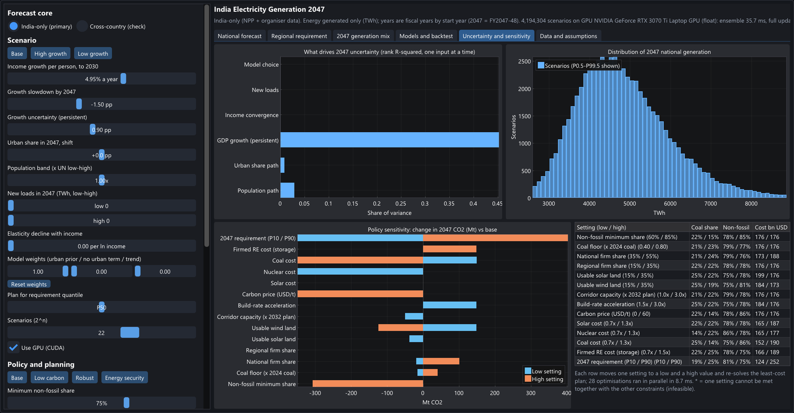

# Results

All numbers are energy generated (TWh).
They come from the default scenario of the primary (India-only) core: 4,194,304 Monte Carlo scenarios, seed 20470815.
Regenerate them with `energy2047 <repo_root>`; the tables are written to `outputs/`.

Years are fiscal years labelled by their start year: 2023 is FY2023-24, 2047 is FY2047-48.
The scope is NPP utility generation; captive plants are reported as a separate layer (section 1.3).

> **Change, 16 November 2026.** The organisers ruled at the kickoff that the core 2047 prediction must use only the two challenge datasets (National Power Portal and the Renewable India dataset).
> The primary forecast is now the India-only model ([methodology.md](methodology.md), section 2).
> The earlier cross-country model (4,536 TWh in 2047) is kept as an independent check (section 1.4).

## 1. National generation requirement

India's utilities generated 1,698 TWh in FY2023-24 (NPP), or 1,225 kWh per person.

| Year | P5 | P10 | P25 | Median | P75 | P90 | P95 |
| --- | --- | --- | --- | --- | --- | --- | --- |
| FY2030-31 | 2,018 | 2,084 | 2,199 | 2,337 | 2,488 | 2,636 | 2,730 |
| FY2035-36 | 2,364 | 2,488 | 2,711 | 2,986 | 3,296 | 3,612 | 3,819 |
| FY2040-41 | 2,735 | 2,927 | 3,280 | 3,730 | 4,254 | 4,802 | 5,170 |
| **FY2047-48** | **3,248** | **3,553** | **4,131** | **4,894** | **5,822** | **6,829** | **7,526** |

- The median requirement for FY2047-48 is **4,894 TWh**, 2.88 times FY2023-24 (4.5 percent a year).
- Generation per person rises to about 3,050 kWh.
- The 80 percent range (P10 to P90) is 3,553 to 6,829 TWh.

Central paths in FY2047-48 (medium drivers, mean growth, point estimates):

| Model | FY2047-48 (TWh) | Role |
| --- | --- | --- |
| India elasticity with the urbanisation prior | 4,729 | Forecast (weight 1) |
| India elasticity, no urban term (two datasets only) | 4,508 | Ablation |
| Damped trend on NPP generation (no drivers) | 3,604 | Benchmark |

### 1.1 Estimation

| Quantity | Value |
| --- | --- |
| Income elasticity, FY2011-12 to FY2023-24 | 0.828 (s.e. 0.063) |
| Income elasticity, FY2006-07 to FY2023-24 (spliced price bases) | 0.896 (s.e. 0.034) |
| First-difference elasticity (pandemic years left out) | 0.782 / 0.869 |
| Elasticity used: block-bootstrap mixture of both windows | median 0.870, 90% interval 0.747 to 0.950 |
| FY2020-21 (pandemic) effect | -0.055 log points |
| Urbanisation prior gamma | normal(1.0, 0.5), truncated at 0 |
| Base-year anchor shift | -0.043 log points |

### 1.2 Validation

| Check | Result |
| --- | --- |
| Rolling backtest, origins FY2012-13 to FY2018-19, MAPE at 1 / 3 / 5 years | 2.3% / 5.1% / 8.1% |
| Holdout FY2024-25 (NPP conventional 1,569 + renewable extended 216 = 1,785) | model 1,713, error -4.0% |
| Holdout FY2025-26 (1,530 + 247 = 1,776) | model 1,805, error +1.6% |

NPP has no renewable generation for the holdout years, so renewable output is extended at its FY2018-19 to FY2023-24 growth rate (14.1 percent a year).
Conventional generation alone fell 2.4 percent in FY2025-26 while renewable output kept rising, so a check on conventional output alone would be biased.

### 1.3 Captive layer

Captive plants generated 224 TWh in FY2023-24 (CEA General Review 2025), 13.2 percent of NPP utility generation.
Holding that share gives **about 5,540 TWh including captive plants** in FY2047-48 (P5 3,676, P95 8,519).
This layer is reported next to the forecast and never enters it.

### 1.4 Independent check: cross-country model

| Core | Scope | Base | 2047 P5 | 2047 median | 2047 P95 |
| --- | --- | --- | --- | --- | --- |
| India-only (primary) | NPP utilities, FY2047-48 | 1,698 (FY2023-24) | 3,248 | 4,894 | 7,526 |
| India-only + captive layer | utilities + captive | 1,922 | 3,676 | 5,540 | 8,519 |
| Cross-country panel (check) | Ember total incl. captive, calendar 2047 | 2,080 (2025) | 3,348 | 4,528 | 5,610 |

The cross-country median lies inside the India-only range but about 18 percent below the India-only total with captive plants.
The difference is the elasticity: across 153 countries the elasticity at India's income is 0.44 to 0.57, falling with income; India's own data show 0.78 to 0.90 with no decline yet.
Setting an elasticity decline of 0.2 per unit of ln income in the India model gives 4,367 TWh (section 4), which brings the two methods together.

**CEA plan.** The CEA National Electricity Plan projects gross generation of 2,666 TWh for FY2031-32.
Our median for FY2031-32 is 2,459 TWh (P90 2,815).

The registration-form figure of 6,000 TWh was a pre-data estimate; including captive plants it lies between our median (5,540) and P75 (6,590).

## 2. Regional requirement

| Region | FY2030-31 median | FY2040-41 median | FY2047-48 P5 | FY2047-48 median | FY2047-48 P95 | Share of requirement 2047 | Share of NPP conventional generation FY2025-26 |
| --- | --- | --- | --- | --- | --- | --- | --- |
| Northern | 645 | 1,049 | 929 | 1,395 | 2,140 | 28.5% | 24.9% |
| Western | 616 | 985 | 862 | 1,301 | 2,010 | 26.6% | 36.0% |
| Southern | 637 | 954 | 776 | 1,194 | 1,873 | 24.4% | 20.1% |
| Eastern | 364 | 616 | 545 | 834 | 1,285 | 17.1% | 17.7% |
| North-Eastern | 75 | 125 | 111 | 167 | 256 | 3.4% | 1.3% |

The requirement is where power is needed (state population and income); NPP generation is where plants are today.

- **Transfer gap.** The Western region produces 36 percent of India's conventional generation but accounts for 27 percent of the 2047 requirement; the Northern and Southern regions need more than they produce today.
- The **Northern** region has the largest requirement because of its population (Uttar Pradesh, Rajasthan).
- The **North-Eastern** share more than doubles relative to today's production share, driven by income convergence and urbanisation.

## 3. 2047 generation strategy

### 3.1 Least-cost plan, base policy

| Region | Coal | Gas | Nuclear | Hydro | Solar | Onshore wind | Offshore wind | Bioenergy | Requirement | Net export |
| --- | --- | --- | --- | --- | --- | --- | --- | --- | --- | --- |
| Northern | 428 | 0 | 127 | 147 | 504 | 153 | 0 | 38 | 1,396 | 0 |
| Western | 317 | 0 | 144 | 20 | 608 | 246 | 58 | 33 | 1,302 | +123 |
| Southern | 219 | 0 | 135 | 34 | 458 | 233 | 88 | 28 | 1,195 | 0 |
| Eastern | 390 | 83 | 51 | 28 | 117 | 10 | 0 | 9 | 834 | -119 |
| North-Eastern | 7 | 18 | 0 | 120 | 20 | 0 | 0 | 1 | 167 | 0 |

National mix: solar 35.0%, coal 27.9%, onshore wind 13.2%, nuclear 9.4%, hydro 7.2%, offshore wind 3.0%, bioenergy 2.3%, gas 2.1%.
Non-fossil share 70.0 percent (the minimum binds); CO2 1,364 Mt; about 233 billion USD a year.

**The base policy falls 28 TWh (0.6 percent) short at the median**, in the Eastern region.
Build rates at twice the record year and 25 percent usable solar and wind land are not quite enough.
Any one of these closes the gap (policy sweep, section 4.2): 35 percent usable solar land, 35 percent usable wind land, or build rates three times the record year.

### 3.2 Recommended plan: Robust policy

| Source | Share of 2047 generation |
| --- | --- |
| Solar | 48.8% |
| Coal | 23.5% |
| Firmed RE (solar and wind with storage, round-the-clock) | 12.4% |
| Hydro | 7.1% |
| Onshore wind | 3.3% |
| Offshore wind | 3.0% |
| Nuclear | 2.0% |

| Region | Coal | Nuclear | Hydro | Solar | Onshore wind | Offshore wind | Firmed RE | Total | Requirement | Net export | Marginal cost (USD/MWh) |
| --- | --- | --- | --- | --- | --- | --- | --- | --- | --- | --- | --- |
| Northern | 361 | 11 | 147 | 706 | 7 | 0 | 176 | 1,408 | 1,396 | +12 | 62.0 |
| Western | 264 | 20 | 20 | 851 | 120 | 58 | 175 | 1,507 | 1,302 | +205 | 60.2 |
| Southern | 128 | 24 | 34 | 641 | 37 | 88 | 243 | 1,195 | 1,195 | 0 | 62.0 |
| Eastern | 390 | 43 | 28 | 164 | 0 | 0 | 12 | 637 | 834 | -197 | 63.0 |
| North-Eastern | 7 | 0 | 120 | 29 | 0 | 0 | 0 | 156 | 167 | -11 | 64.8 |

Each region uses its strengths: Rajasthan solar and Himalayan hydro in the North; Gujarat and Maharashtra solar, wind and Gulf of Khambhat offshore wind in the West (the largest exporter); Tamil Nadu and Karnataka wind, offshore wind and firmed solar in the South; the coal fleet in the East, which imports about 200 TWh; Arunachal hydro in the North-East.

Non-fossil 76.5 percent; CO2 1,114 Mt; about 188 billion USD a year; **no unmet energy at the median**.
It is cheaper and cleaner than the base policy.
It needs 35 percent of the solar potential usable (including rooftop and agri-PV), 30 percent of the wind potential, corridors three times the 2032 plan and build rates 2.5 times India's record year.

### 3.3 What the P90 requirement takes

Planned for the 90th-percentile requirement (6,829 TWh), the Robust policy leaves 1,067 TWh unmet.
Land for solar is the binding constraint (`outputs/p90_levers.csv`, unmet TWh):

| Build rate (x record year) | 35% usable solar | 45% | 55% |
| --- | --- | --- | --- |
| 2.5 | 1,067 | 156 | 0 |
| 3.0 | 933 | 26 | 0 |
| 3.5 | 799 | 0 | 0 |
| 4.0 | 664 | 0 | 0 |

Faster building alone does not close the gap; usable solar land (rooftop, agri-PV, canal-top and floating solar) does.

### 3.4 Scenario and policy presets

Each scenario preset is crossed with each policy preset ([assumptions_and_uncertainty.md](assumptions_and_uncertainty.md), section 6; full table in `outputs/presets.csv`).

| Scenario | Policy | 2047 median (TWh) | Non-fossil | Coal | CO2 (Mt) | Cost (bn USD) | Unmet at median (TWh) | Unmet at P90 (TWh) |
| --- | --- | --- | --- | --- | --- | --- | --- | --- |
| Base | Base | 4,894 | 70.0% | 27.9% | 1,364 | 233 | 28 | 1,958 |
| Base | Low carbon | 4,894 | 80.0% | 17.0% | 865 | 211 | 47 | 1,979 |
| Base | **Robust** | 4,894 | **76.5%** | **23.5%** | **1,114** | **188** | **0** | **1,067** |
| Base | Energy security | 4,894 | 70.0% | 28.0% | 1,366 | 233 | 30 | 1,958 |
| High growth | Base | 7,088 | 70.0% | 30.0% | 1,416 | 240 | 2,217 | 5,060 |
| High growth | Robust | 7,088 | 75.0% | 25.0% | 1,396 | 256 | 1,326 | 4,169 |
| Low growth | Base | 3,516 | 77.4% | 22.6% | 772 | 134 | 0 | 0 |
| Low growth | Robust | 3,516 | 81.2% | 18.8% | 643 | 125 | 0 | 0 |

### 3.5 Storage and land the plans need

Each least-cost plan is dispatched hour by hour over a representative year built from NPP Merit hourly generation ([methodology.md](methodology.md), section 6.4; full table in `outputs/storage_land_2047.csv`).
Storage power and energy are physical sizes of the plan, not forecasts.

| Plan (2047 requirement) | Storage power | Storage energy (daily cycle) | Duration | Curtailed solar and wind | Shortfall left after storage | Solar and wind land | Share of India's area |
| --- | --- | --- | --- | --- | --- | --- | --- |
| **Robust policy, median (4,894 TWh)** | **437 GW** | **2,966 GWh** | **6.8 h** | **3.7%** | **244 TWh (5.0%)** | **19,990 km²** | **0.61%** |
| Base policy, median (4,894 TWh) | 246 GW | 1,638 GWh | 6.6 h | 3.6% | 151 TWh (3.1%) | 14,403 km² | 0.44% |
| Robust policy at P90 with the P90 levers (6,829 TWh) | 539 GW | 3,625 GWh | 6.7 h | 1.6% | 223 TWh (3.3%) | 25,402 km² | 0.77% |

**Storage.**
Before storage, load exceeds supply in about 5,390 hours a year in the Robust plan, mostly evenings and nights after the solar peak.
The design day is 12 April 2026, before the monsoon, with high load, strong sun and little wind; the median day needs 2,312 GWh.
The store cycles about 250 times a year, discharges 734 TWh (15 percent of the requirement) and loses 129 TWh in the round trip.
In the Robust plan, plain solar is already at its usable limit, so the firmed RE that the LP builds uses wind potential and counts here as 606 TWh of onshore wind.
If firmed RE is instead treated as a round-the-clock block with its storage inside the plants, the rest of the system needs 450 GW and 3,234 GWh.
The two views put the Robust plan's storage at about 440 to 450 GW and 3.0 to 3.2 TWh.

**Multi-day storage does not pay.**
Carrying energy between days helps little.
In the Robust plan, doubling the store's energy cuts the remaining shortfall only from 240 to 225 TWh, so each extra GWh serves about 5 GWh a year.
The multi-day size therefore equals the daily size; the remaining shortfall is weather over weeks and seasons, which firm generation has to cover.
Unlimited charging power would save only 12 TWh, so the power rating is not the limit either.

**The plans need about 3 to 5 percent more generation.**
The shortfall left after storage is the storage losses (129 TWh in the Robust plan) plus days when the sun and wind fall short (about 115 TWh).
Annual energy balances in the LP do not see either, so the plan needs that much more generation, for example more solar with storage or longer coal running.
With a stiffer coal fleet (minimum 55 percent instead of 40 percent) the Robust plan needs 459 GW and 3,143 GWh.
With a 75 percent round trip, typical of pumped storage, the shortfall left rises to 313 TWh.

**Comparison with CEA.**
CEA's optimal mix for 2029-30 needs 60.6 GW and 336 GWh of storage (18.98 GW pumped storage and 41.65 GW batteries) for 2,441 TWh of generation with 31 percent solar and wind ([CEA, April 2023](https://jmkresearch.com/wp-content/uploads/2023/05/Report_on_Optimal_Generation_Mix_in_year_2030_1683189805.pdf), section 8.1.2).
That is 0.44 GWh of storage per TWh of solar and wind and 5.5 hours.
The 2047 plans need 0.66 (Base) to 0.90 (Robust) GWh per TWh at 6.6 to 6.8 hours.
Storage energy grows 5 to 9 times from 2029-30 while solar and wind generation grows 3 to 4 times, as expected when solar's share rises.
The Ministry of Power's Annual Report 2025-26 already projects 62 GW of pumped storage (6 to 7 hours) and 99 GW / 396 GWh of batteries for 2034-35 (`data/external/techno_economic/policy_targets.csv`).

**Land.**
The Robust plan's solar needs 18,942 km² at India's norm of 4 acres per MW, or 32,887 km² at NREL's US average, and the wind turbines take 1,047 km².
Together that is 0.61 percent of India's area and 3.6 percent of its wasteland.
Wind farms also spread over about 120,000 km², most of which stays in farming.
The densest regions are the Southern (0.85 percent of its area), Western (0.74 percent) and Northern (0.58 percent).
The solar uses 35 percent of the NISE ground-mounted solar potential, all of the usable share in the Robust policy.
Meeting the P90 requirement with 45 percent of that potential raises the land to 25,402 km² (0.77 percent).
All solar is counted as ground-mounted; rooftop and agri-PV would reduce the land.

## 4. Sensitivity

### 4.1 Requirement (FY2047-48, `outputs/sensitivity_2047.csv`)

| Case | P5 | Median | P95 | Median vs base |
| --- | --- | --- | --- | --- |
| Base | 3,248 | 4,894 | 7,526 | |
| Income growth 1.5 points above history | 4,259 | 6,453 | 10,064 | +32% |
| Income growth 1.5 points below history | 2,461 | 3,714 | 5,650 | -24% |
| Elasticity falls 0.2 per unit of ln income | 3,139 | 4,367 | 5,980 | -11% |
| Urban share 5 points above the UN path | 3,387 | 5,151 | 7,943 | +5% |
| No urban term (two datasets only) | 2,973 | 4,647 | 7,438 | -5% |
| Population uncertainty doubled | 3,181 | 4,885 | 7,627 | 0% |
| Damped trend (no drivers) | 2,807 | 3,604 | 4,627 | -26% |

**Income growth dominates.** The elasticity and the urbanisation term move the median by 5 to 11 percent; the income path moves it by a quarter to a third.

### 4.2 Policy settings (base plan: 1,364 Mt CO2, 233 billion USD, 28 TWh unmet)

| Setting (low / high) | CO2 (Mt) | Unmet (TWh) | Cost (bn USD) |
| --- | --- | --- | --- |
| Requirement (P10 / P90) | 772 / 1,416 | 0 / **1,958** | 136 / 236 |
| Usable solar land (15% / 35%) | 1,132 / 1,240 | **999** / 0 | 199 / 191 |
| Usable wind land (15% / 35%) | 1,309 / 1,415 | 391 / 0 | 211 / 220 |
| Build-rate acceleration (1.5x / 3.0x) | 1,344 / 1,420 | 168 / 0 | 221 / 232 |
| Carbon price (0 / 60 USD/t) | 1,364 / 1,290 | 28 / 27 | 233 / 236 |
| Coal cost (0.7x / 1.3x) | 1,416 / 1,302 | 32 / 27 | 200 / 261 |
| Non-fossil minimum (60% / 85%) | 1,479 / infeasible | 0 / - | 230 / - |

Lower CO2 with 15 percent solar land is not an improvement: it comes from unmet requirement.

## 5. Performance

| Run | 1,048,576 scenarios | Scenarios per second |
| --- | --- | --- |
| CPU, 1 thread | 22.7 s | 46,000 |
| CPU, 16 threads (OpenMP) | 2.07 s | 507,000 |
| GPU, RTX 3070 Ti Laptop (CUDA) | 7.5 ms | 140 million |

These were measured on an otherwise idle machine on 15 November 2026; CPU timings vary with background load.
The India-only core fits in under 0.2 s at start-up (2,000 block-bootstrap replicates in a few milliseconds); 4.2 million scenarios take about 30 ms on the GPU.
